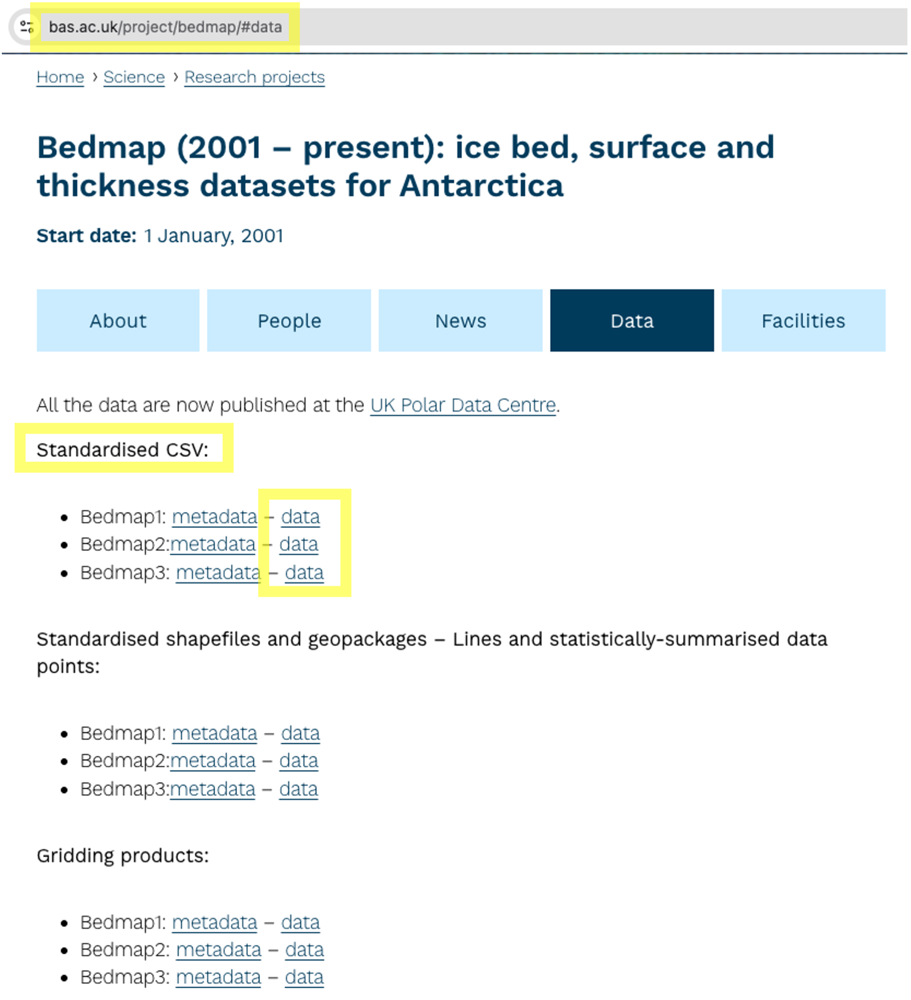
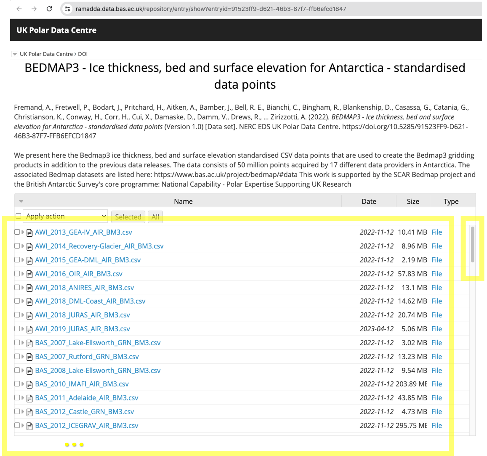

# Processing the Bedmap3 source data collection
## [Antarctic ice thickness and bed topography / bed elevation observations]

This repository contains an end-to-end **Python preprocessing pipeline** for the **Bedmap3** source data collection (all standardised csv files), as used in [Pritchard et al. 2025](https://www.nature.com/articles/s41597-025-04672-y) (i.e. the Bedmap3 map), and described in [Fremand et al. 2023](https://essd.copernicus.org/articles/15/2695/2023/), (i.e. the data paper).

### Inputs
- 151 standardised (but relatively raw) .csv files, one per survey data set, from the Bedmap1, Bedmap2 and Bedmap3 collections, which together cover all surveys in the cumulative Bedmap compilation over Antarctica (see https://www.bas.ac.uk/project/bedmap/).

### Outputs
- `bedmap123.csv` a single .csv file that combines all these individual survey data sets into one and applies basic consistency checks.
- `bedmap123_metadata.csv` the corresponding meta data set. 
- `bedmap123_subset_{region}.csv` a subset of `bedmap123.csv` for a smaller rectangular region, defined by it's Antarctic Polar Stereographic corner coordinates. 

## Preprocessing pipeline 

The following downloading and preprocessing pipeline is fully **reproducible**.

### Step 1 - Download Bedmap
- In `real_data_step1_download_bedmap123.py` replace `path_to_bedmap_data_folder` with your own local path. Run the python script with `python real_data_step1_download_bedmap123.py` from the terminal. This will automatically download, unzip, and organise all **Bedmap** data files. Specify the downloader (wget or curl) based on your operating system. The script has only been tested on os. If you have trouble with this script or you are not on os, also see this [BAS resource from the Geophyscis Book by the UK Polar Centre](https://antarctica.github.io/PDC_GeophysicsBook/BEDMAP/Downloading_the_Bedmap_data.html) for useful information.
- 
<strong>WARNING:</strong> This script downloads 11 GB of data!

    - Bedmap1: 0.157 GB  
    - Bedmap2: 3.2 GB  
    - Bedmap3: 6.8 GB  
- All standardised .csv files from the Bedmap1, Bedmap2 and Bedmap3 collections are downloaded from the [UK Polar Data Centre](https://www.bas.ac.uk/data/uk-pdc/). The lists of .csv files are visible on [this Bristish Antarctic Survey (BAS) webpage](https://www.bas.ac.uk/project/bedmap/#data).
- Also check out this [Github repository](https://github.com/kimbente/bedmap) for some additional analysis of Bedmap123 data.
- Bedmap3 references:
    - *Pritchard, Hamish D., et al. "Bedmap3 updated ice bed, surface and thickness gridded datasets for Antarctica." Scientific data 12.1 (2025): 414.*
    - *Frémand, Alice C., et al. "Antarctic Bedmap data: Findable, Accessible, Interoperable, and Reusable (FAIR) sharing of 60 years of ice bed, surface, and thickness data." Earth System Science Data 15.7 (2023): 2695-2710.*

### Step 2 - Preprocess Bedmap (combine, clean, subset region)

- In `real_data_step2_preprocess_bedmap123.py`, specify your preference about which variable you care about (i.e. ice thickness or bed elevation) by setting bool_remove_rows_without_ice_thickness and/or bool_remove_rows_without_bed_elevation. Also make sure you set `path_to_bedmap_data_folder` to the same path you used for the download script in Step 1. Here, we set `bool_remove_rows_without_ice_thickness = True` because we will be using ice thickness measurements.
    - For only `bool_remove_rows_without_ice_thickness = True` the resulting data set contains ~ 82 M points (i.e. rows.) and is 9.5 GB large.
    - For only `bool_remove_rows_without_bed_elevation = True` the resulting data set contains ~ 67 M points (i.e. rows.)
- Run the script with `python real_data_step2_preprocess_bedmap123.py` from the terminal.
- The script combines all csv files into a standardised pd.Dataframe (pandas) and performs a set of cleaning and preprocessing steps.
- Number of csv files to combine: 151 
    - Number of bedmap1 csv files: 1
    - Number of bedmap2 csv files: 66
    - Number of bedmap3 csv files: 84
- Next - if toggled on - the data is subsetted for a region. As an example we create a subset for the Byrd catchment regions. The subset of data for this 300 x 300 km region is more managable in size and only contains 750k data points, reducing the file size to 0.085 GB. Antarctic Polar Stereographic boundry coordinates (see [EPSG:3031](https://epsg.io/3031)) are used to subset the data. For a user-friendly, non-programmatic conversion between regular geographic coordinates and Polar Stereographic coordinates we recommend [this conversion webtool by the Polar Geospatial Center (University of Minnesota)](https://www.pgc.umn.edu/apps/convert/).

## List of files with brief explanantions

- [real_data_step1_download_bedmap123.py](real_data_step1_download_bedmap123.py) downloads all standardised raw data from Bedmap1, Bedmap2, and Bedmap3.
- [real_data_step2_preprocess_bedmap123.py](real_data_step2_preprocess_bedmap123.py) preprocesses and cleans the downloaded raw datasets to then generate one pd.Dataframe.

## Links to research projects that use this preprocessing pipelineß

- [https://github.com/kimbente/FluxNet](https://github.com/kimbente/FluxNet): **Deep Learning Ice Shelf Basal Melt Rates via Differentiable Physics** (Kim Bente, Roman Marchant, Fabio Ramos), accepted at Climate Informatics 2026.
- [https://github.com/kimbente/mass_conservation_on_rails](https://github.com/kimbente/mass_conservation_on_rails): **Mass Conservation on Rails - Rethinking Physics-Informed Learning of Ice Flow Vector Fields** (Kim Bente, Roman Marchant, Fabio Ramos), accepted at the NeurIPS 2025 Workshop on Tackling Climate Change with Machine Learning.
- [https://github.com/kimbente/dfNGP](https://github.com/kimbente/dfNGP): **Frozen Constraints, Fluid Uncertainty: Physics-Informed Probabilistic Modelling of Mass-Conserving Flow Fields for Environmental Applications** (Kim Bente, Roman Marchant, Fabio Ramos), under review.
- [https://github.com/kimbente/BO4AIS](https://github.com/kimbente/BO4AIS): **Bayesian Optimisation (BO) for the Antarctic Ice Sheet (AIS)**, accepted at the EGU 2026 Machine Learning for Cryospheric Sciences session.

# Contact

For any comments, questions or otherwise, please contact kim.bente@utas.edu.au

# Timestamp

This processing pipeline was last updated on *14 October 2026*.

# Annotated Screenshots

## Location of processed data files on website

# Overview of e.g. Bedmap3 standardised csv file collection

